# ConnectML - Plano de Execução das Sprints: Fase 9 (Versão 1.3.4)
**Detalhamento Técnico das Sprints de Desenvolvimento: Aprimoramentos do HUD, Hit-Testing Geométrico e Rastreabilidade QIF com Número de Série**

Este documento detalha passo a passo as tarefas de desenvolvimento, arquivos afetados, contratos de código e critérios de aceite para cada uma das Sprints da **Fase 9 (v1.3.4)**, complementando a especificação arquitetural de [ip-p9_v134-adjustments-and-enhancements.md](file:///c:/Antigravity/ConnectML/docs/implementations/v1.3.4/ip-p9_v134-adjustments-and-enhancements.md).

---

## 🗺️ Mapa de Execução das Sprints

```mermaid
gantt
    title Roteiro de Execução - Fase 9 (v1.3.4)
    dateFormat  X
    axisFormat %s
    section Sprint 9.1
    Branching, Bump v1.3.4 & QIF SerialNumber Parser      :active, s1, 0, 1
    section Sprint 9.2
    Hit-Testing de Borda Estrita & Reposicionamento Grip : s2, 1, 2
    section Sprint 9.3
    Desacoplamento de Escala & Espaçamento dos Controles  : s3, 2, 3
    section Sprint 9.4
    Estado Interrompido (Cinza) & Ciclo de Vida do HUD    : s4, 3, 4
    section Sprint 9.5
    Validação E2E com QIF Real & Documentação Técnica     : s5, 4, 5
```



---

## 🚀 Sprint 9.1: Branching, Version Bump Global (v1.3.4) e Parser QIF com Número de Série

### 🎯 Objetivo
Configurar a estrutura de versionamento da versão `1.3.4` em toda a solução e estender o `QifParser` para extrair de forma resiliente a tag `<SerialNumber>` correlacionada à medição mais recente, validando contra arquivos reais de chão de fábrica.

### 📋 Tarefas Técnicas

#### 1. Setup de Branches Git
- Branch base de release: `release/v1.3.4` (criada a partir de `main`).
- Branch ativa de desenvolvimento: `feature/v1.3.4-enhancements` (criada a partir de `release/v1.3.4`).

#### 2. Bump de Versão Global (1.3.3 -> 1.3.4)
- **`ConnectML.Core/ConnectML.Core.csproj`**: `<Version>1.3.4</Version>`
- **`ConnectML.Infrastructure/ConnectML.Infrastructure.csproj`**: `<Version>1.3.4</Version>`
- **`ConnectML.Simulator/ConnectML.Simulator.csproj`**: `<Version>1.3.4</Version>`
- **`ConnectML.UI/ConnectML.UI.csproj`**: `<Version>1.3.4</Version>`
- **`ConnectML.UI/Program.cs`**:
  ```csharp
  IntPtr hWnd = FindWindow(null, "ConnectML - V1.3.4");
  ```
- **`ConnectML.UI/MainWindow.xaml`**:
  ```xml
  Title="ConnectML - V1.3.4"
  ```
  e no rodapé do painel de logs:
  ```xml
  <TextBlock Text="Versão 1.3.4" FontSize="10" Foreground="{StaticResource TextSecondary}" VerticalAlignment="Center"/>
  ```

#### 3. Implementação da Extração de SerialNumber em `QifParser.cs`
- **Arquivo**: [ConnectML.Core/QifParser.cs](file:///c:/Antigravity/ConnectML/ConnectML.Core/QifParser.cs)
- **Assinatura**:
  ```csharp
  public static (bool IsOk, int FailCount, string Product, string SerialNumber) Parse(string filePath)
  ```
- **Lógica de Resolução**:
  1. No `latestMeasurement` selecionado, localiza `<ActualComponentIds>` e extrai o `<Id>`.
  2. Localiza em `<ActualComponentSets>` o nó `<ActualComponent id="X">`.
  3. Lê `<SerialNumber>`.
  4. Fallback: se `<ActualComponentIds>` estiver ausente, recupera o último `<ActualComponent>` do documento que possua `<SerialNumber>`.

### 🛡️ Critérios de Aceite da Sprint 9.1
- [x] Compilação de todos os 4 projetos sem warnings ou erros com `dotnet build`.
- [x] O parser extrai com sucesso `"101807776895"` do arquivo `C:\Mitutoyo\ConnectML\MANPESADO_20261024_130323.QIF`.
- [x] O parser extrai com sucesso `"152"` do arquivo `C:\Mitutoyo\ConnectML\QIF-BOM.QIF`.
- [x] Arquivos sem `<SerialNumber>` retornam string vazia sem lançar exceções.

---

## 🎯 Sprint 9.2: Geometria de Hit-Testing e Reposicionamento do Grip no HUD

### 🎯 Objetivo
Corrigir a imprecisão de redimensionamento da borda perimetral e da aba, confinando a captura de clique-arraste a uma faixa estreita milimétrica na aresta da borda e reposicionando o grip de redimensionamento no canto inferior direito da aba.

### 📋 Tarefas Técnicas

#### 1. Calibração da Borda Perimetral (`BorderResizeStrips`)
- **Arquivo**: [ConnectML.UI/OverlayWidgetWindow.xaml.cs](file:///c:/Antigravity/ConnectML/ConnectML.UI/OverlayWidgetWindow.xaml.cs)
- **Método**: `UpdateBorderResizeStrips()`
- **Implementação**:
  - Definir a espessura da tira de captura como fixa em 8px.
  - Aplicar `Margin` para centralizar a tira exatamente sobre a aresta interna da borda:
    ```csharp
    double offset = Math.Max(0, _borderThickness - 4);
    BorderResizeTop.Height = 8;
    BorderResizeTop.Margin = new Thickness(0, offset, 0, 0);

    BorderResizeBottom.Height = 8;
    BorderResizeBottom.Margin = new Thickness(0, 0, 0, offset);

    BorderResizeLeft.Width = 8;
    BorderResizeLeft.Margin = new Thickness(offset, 0, 0, 0);

    BorderResizeRight.Width = 8;
    BorderResizeRight.Margin = new Thickness(0, 0, offset, 0);
    ```
  - Isso garante que o usuário só ative o cursor de redimensionamento ao tocar na aresta da borda (4px para fora e 4px para dentro).

#### 2. Calibração da Borda Externa da Aba (`TabEdgeResizeStrip`)
- **Arquivos**: [ConnectML.UI/OverlayWidgetWindow.xaml](file:///c:/Antigravity/ConnectML/ConnectML.UI/OverlayWidgetWindow.xaml) e [OverlayWidgetWindow.xaml.cs](file:///c:/Antigravity/ConnectML/ConnectML.UI/OverlayWidgetWindow.xaml.cs)
- Garantir que a tira de clique-arraste da aba acompanhe o limite externo real de `OverlayTabContainer`, eliminando o descompasso com o padding interno.

#### 3. Reposicionamento do Grip Visual no Canto da Aba
- Remover o `TabResizeGrip` do fluxo sequencial horizontal de `TabContentPanel`.
- Posicioná-lo ancorado diretamente no canto inferior direito de `OverlayTabContainer` (para dock `TOP`), ou no canto relevante conforme orientação.
- Manter o visual do triângulo diagonal indicativo de redimensionamento encostado ao canto.

### 🛡️ Critérios de Aceite da Sprint 9.2
- [x] O cursor de redimensionamento da borda só é ativado na aresta da borda perimetral. Clicar no meio de uma borda grossa (ex: 30px) ou fora dela não dispara o resize.
- [x] Posicionar o mouse exatamente na borda externa da aba ativa o cursor de redimensionamento.
- [x] O ícone diagonal de redimensionamento fica posicionado harmoniosamente no canto da aba.

---

## 🎨 Sprint 9.3: Desacoplamento de Escala dos Controles e Espaçamento da Aba

### 🎯 Objetivo
Desacoplar a escala dos controles operacionais da aba do HUD para que apenas o título principal e o círculo de estado aumentem de tamanho, garantindo dimensões estáveis e espaçamento elegante em relação aos botões auxiliares.

### 📋 Tarefas Técnicas

#### 1. Refatoração de `SetFontSize(double size)`
- **Arquivo**: [ConnectML.UI/OverlayWidgetWindow.xaml.cs](file:///c:/Antigravity/ConnectML/ConnectML.UI/OverlayWidgetWindow.xaml.cs)
- **Ajustes de Dimensionamento**:
  - `TxtOverlayStatus.FontSize = _fontSize;` (11 a 60 pt).
  - `StateDot.Width = Math.Round(_fontSize * 0.6); StateDot.Height = StateDot.Width;` (escala com a fonte).
  - Controles estáticos:
    - `IconSettingsViewbox`: fixo em 14x14 px (com clamp se fonte < 12pt).
    - `IconRestoreViewbox`: fixo em 13x13 px.
    - `TxtBtnRestore.FontSize`: fixo em 11 pt.
    - `GripViewbox` (pontos de arrasto): fixo em 10x14 px.
    - `ResizeGripViewbox`: fixo em 12x12 px.
    - Separadores: altura fixa ou proporcional discreta.

#### 2. Distribuição Espacial e Margens dos Botões
- Criar espaçamento flexível entre o título e os botões (`BtnOverlaySettings`, `BtnRestoreMainWindow`, `TabResizeGrip`), impedindo aglomeração de controles no centro da aba.
- Garantir comportamento responsivo harmonioso para qualquer valor de fonte entre 11 e 60 pt.

### 🛡️ Critérios de Aceite da Sprint 9.3
- [x] Em fontes grandes (ex: 30 a 60 pt), os ícones de configurações, abrir e grip mantêm proporções limpas (~14px) sem hipertrofia.
- [x] O título da mensagem e o ponto indicador continuam ampliados e legíveis à distância.
- [x] Há espaçamento adequado entre o texto principal e os botões de ação.

---

## ⚙️ Sprint 9.4: Estado "PROCESSAMENTO INTERROMPIDO" e Integração com MainWindow

### 🎯 Objetivo
Implementar o estado visual cinza sem pulso no HUD para sinalizar quando o processamento não está ativo, e atualizar o disparo de medição concluída para o formato `<ROTINA> / <SERIALNUMBER>`.

### 📋 Tarefas Técnicas

#### 1. Implementação de `SetInterruptedState()` em `OverlayWidgetWindow`
- **Arquivo**: [ConnectML.UI/OverlayWidgetWindow.xaml.cs](file:///c:/Antigravity/ConnectML/ConnectML.UI/OverlayWidgetWindow.xaml.cs)
- Definir `GrayBrush = new SolidColorBrush((Color)ColorConverter.ConvertFromString("#64748B"));`.
- Criar método `SetInterruptedState()`:
  - Título: `"PROCESSAMENTO INTERROMPIDO"`.
  - Cor das bordas e ponto: `GrayBrush`.
  - Opacidade: 1.0 (sólido).
  - Storyboard de pulso: Parado (`_pulseStoryboard?.Stop(this);`).

#### 2. Sincronização de Ciclo de Vida em `MainWindow.xaml.cs`
- **Arquivo**: [ConnectML.UI/MainWindow.xaml.cs](file:///c:/Antigravity/ConnectML/ConnectML.UI/MainWindow.xaml.cs)
- Em `BtnMinimize_Click` e no evento de mudança de janela:
  - Se `_isRunning`: invocar `SetWaitingState()` (ou manter estado atual).
  - Se `!_isRunning`: invocar `SetInterruptedState()`.
- Em `StartService()`: se o HUD estiver aberto, comutar para `SetWaitingState()`.
- Em `StopService()`: se o HUD estiver aberto/minimizado, comutar para `SetInterruptedState()`.

#### 3. Formatação da Notificação no HUD
- Em `ProcessFile(filePath)`:
  - Formatar a mensagem do HUD:
    ```csharp
    string hudMessage = !string.IsNullOrWhiteSpace(result.SerialNumber)
        ? $"{result.Product} / {result.SerialNumber}"
        : result.Product;
    _overlayWindow?.TriggerMeasurementCompleted(holdSec, hudMessage);
    ```
  - Atualizar balão de notificação no System Tray.

### 🛡️ Critérios de Aceite da Sprint 9.4
- [x] Minimizar a aplicação com o serviço parado exibe o HUD em cinza com o título `"PROCESSAMENTO INTERROMPIDO"`.
- [x] Iniciar o serviço muda imediatamente o HUD para amarelo pulsante com `"AGUARDANDO MEDIÇÃO"`.
- [x] O processamento de um arquivo QIF com serial exibe no HUD o formato `<ROTINA> / <SERIALNUMBER>` em verde sólido.

---

## 🧪 Sprint 9.5: Validação Integrada E2E, Documentações e Fechamento

### 🎯 Objetivo
Executar bateria completa de testes ponta a ponta com arquivos reais, atualizar os mapas de codebase e arquitetura e preparar os artefatos de release.

### 📋 Tarefas Técnicas
1. Teste de fluxo completo com `C:\Mitutoyo\ConnectML\MANPESADO_20261024_130323.QIF`.
2. Teste de redimensionamento nos 4 pontos de ancoragem (`TOP`, `BOTTOM`, `LEFT`, `RIGHT`).
3. Atualização de [docs/AI_CODEBASE_MAP.md](file:///c:/Antigravity/ConnectML/docs/AI_CODEBASE_MAP.md) e [docs/ARCHITECTURE.md](file:///c:/Antigravity/ConnectML/docs/ARCHITECTURE.md).
4. Criação do relatório de entrega da v1.3.4 em `docs/implementations/v1.3.4/ip-p9_release-v134-delivery.md`.

### 🛡️ Critérios de Aceite da Sprint 9.5
- [x] Todos os testes executados com sucesso em ambiente de simulação/local.
- [x] Documentação técnica sincronizada com a versão 1.3.4.
