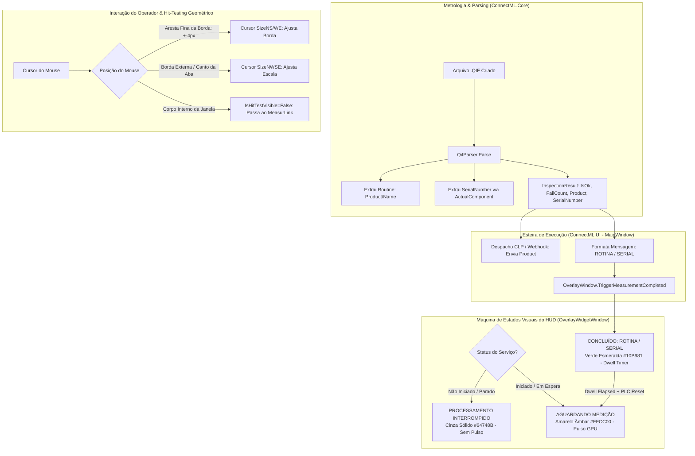

# Implementation Plan: Fase 9 - Ajustes e Aprimoramentos do HUD e Metrologia QIF (Versão 1.3.4)

Este documento estabelece o projeto de arquitetura, análise de impacto e o roteiro técnico detalhado para a implementação do pacote de ajustes da versão **1.3.4** do ConnectML, abrangendo a extração do número de série no QIF, calibração geométrica de hit-testing de redimensionamento do HUD, controle de responsividade da aba e a introdução do estado visual de processamento inativo/interrompido.

> [!IMPORTANT]
> **User Review Required & Pontos de Alinhamento**
> 1. **Formatação de Exibição no HUD**:
>    - Na v1.3.3, o HUD exibia `Peça: <NOME_DA_ROTINA>` (ex: `Peça: D-1001`).
>    - **Decisão Confirmada**: Exibir estritamente sem o prefixo `"Peça:"` em ambos os casos:
>      - Com Serial Number: `<ROTINA> / <SERIALNUMBER>` (ex: `D-1001 / 123456`).
>      - Sem Serial Number (Fallback): `<ROTINA>` (ex: `D-1001`).
>    - A comunicação externa (CLP Siemens S7 e Webhook) permanece 100% inalterada, transmitindo exclusivamente a rotina (`result.Product`).
> 2. **Isolamento de Comunicação PLC / Webhook**:
>    - A variável string enviada ao PLC Siemens S7 (`txtDbPartNumber`) e o payload base do Webhook continuarão transmitindo exclusivamente a rotina (`result.Product`), garantindo compatibilidade reversa estrita com os blocos de dados de CLP já configurados em chão de fábrica.
> 3. **Geometria de Hit-Testing Estrita na Borda**:
>    - Atualmente, as tiras interativas de redimensionamento da borda cobriam toda a espessura da borda mais 10px internos (`_borderThickness + 10`), causando ativação precoce do cursor e invasão indevida da área operacional do MeasurLink.
>    - **Solução**: Restringir o redimensionamento a uma faixa estreita de ±4px centralizada estritamente na aresta interna da borda. Clicar no corpo interno da borda ou fora dessa faixa estreita passará os cliques 100% livres para o MeasurLink.
> 4. **Ancoragem Visual do Grip no Canto da Aba**:
>    - O ícone indicador de redimensionamento (`TabResizeGrip`) será desvinculado do centro do `StackPanel` e ancorado diretamente no canto inferior direito da aba (ou canto correspondente conforme o dock `TOP`, `BOTTOM`, `LEFT`, `RIGHT`), comunicando com máxima fidelidade visual o ponto de interação.
> 5. **Estado Interrompido no HUD**:
>    - Quando a janela principal estiver minimizada mas o serviço de monitoramento não estiver ativo (`_isRunning == false`), o HUD apresentará o título `"PROCESSAMENTO INTERROMPIDO"`, em cinza sólido (`#64748B`), sem animação de pulso.

---

## 🔍 1. Contexto Operacional e Diagnóstico de Necessidades

### 1.1 Item 1: Rastreabilidade por Número de Série no QIF
- **Cenário Atual**: O `QifParser` extrai o nome do produto/rotina (`<Product><Header><Name>`) e o status de aprovação (`PASS`/`FAIL`). O HUD sinaliza o término da medição exibindo apenas a rotina.
- **Necessidade**: Operadores e inspetores de qualidade necessitam validar visualmente no HUD em tela cheia tanto a rotina de inspeção quanto o número de série da peça recém-inspecionada gerada pelo MeasurLink.
- **Estrutura no QIF**:
  - O elemento `<MeasurementResults>` da medição mais recente contém a referência `<ActualComponentIds><Id>X</Id></ActualComponentIds>`.
  - O elemento `<ActualComponent id="X">` dentro de `<ActualComponentSets>` contém a tag `<SerialNumber>`.
  - Exemplo real verificado (`MANPESADO_20261024_130323.QIF`):
    - Rotina: `MANPESADO`
    - Medição Recente: `id="110"`, referenciando componente `id="113"`
    - Componente: `<ActualComponent id="113"><SerialNumber>101807776895</SerialNumber></ActualComponent>`
    - Exibição Alvo: `MANPESADO / 101807776895`.

### 1.2 Item 2: Usabilidade e Calibração Geométrica do HUD
- **Problema 2.1.1 (Hit-Testing da Borda)**: A área de captura de clique-arraste da borda completa do HUD ativava o cursor longe da borda e ocupava toda a sua espessura, impedindo que o operador clicasse livremente em elementos do MeasurLink próximos ao perímetro da tela.
- **Problema 2.1.2 (Hit-Testing da Aba e Posição do Grip)**:
  - O redimensionamento da aba não funcionava ao posicionar o mouse na sua borda externa devido à compensação de padding interno.
  - O ícone indicador de redimensionamento ficava no meio do painel de botões em vez de estar no canto extremo da aba.
- **Problema 2.2 (Hipertrofia de Controles e Espaçamento)**:
  - Ao aumentar o tamanho da fonte da aba para visualização à distância (até 60pt), os botões auxiliares (Configurações, Abrir, Grip de arrasto e Resize grip) cresciam desproporcionalmente, ocupando quase todo o espaço da aba e comprimindo o título contra os botões.

### 1.3 Item 3: Transparência de Estado do Processamento (Modo Inativo)
- **Cenário Atual**: Se o operador minimiza a aplicação antes de clicar em "Iniciar" (ou após parar o serviço), o HUD abre com a mensagem `"AGUARDANDO MEDIÇÃO"` e pulso amarelo ativado.
- **Problema**: O operador do MeasurLink é induzido a acreditar que o sistema está monitorando ativamente a pasta e pronto para enviar sinais ao CLP, quando na verdade o FileSystemWatcher está desligado.
- **Solução**: Exibir `"PROCESSAMENTO INTERROMPIDO"` com cor cinza neutra estática, sinalizando inatividade sem ambiguidade.

---

## 🎯 2. Estratégia Arquitetural e Fluxo de Dados



---

## 🧩 3. Detalhamento dos Componentes Técnicos

### 3.1 QifParser Tolerante a SerialNumber
- **Assinatura Estendida**:
  ```csharp
  public static (bool IsOk, int FailCount, string Product, string SerialNumber) Parse(string filePath)
  ```
- **Lógica de Localização do Componente**:
  1. Identifica a medição mais recente via atributo `id` de `<MeasurementResults>`.
  2. Localiza o nó `<ActualComponentIds>` filho da medição mais recente e obtém o primeiro `<Id>`.
  3. Busca em `<ActualComponentSets>` o nó `<ActualComponent>` cujo atributo `id` corresponde ao ID mapeado.
  4. Extrai o texto da tag `<SerialNumber>`.
  5. **Mecanismo de Resiliência (Fallback)**: Caso `<ActualComponentIds>` não exista ou a correspondência falhe, busca o último `<ActualComponent>` cadastrado em `<ActualComponentSets>` com tag `<SerialNumber>` preenchida. Se ausente, retorna string vazia `""`.

### 3.2 Calibração de Hit-Testing e Layout do HUD
- **Borda Perimetral**:
  - Modificação do método `UpdateBorderResizeStrips()`:
    - Em vez de cobrir `_borderThickness + 10` a partir da coordenada 0, as tiras interativas assumem espessura fixa de **8px**, posicionadas com `Margin` centrado exatamente na aresta interna da borda:
      ```csharp
      // Faixa estreita de 8px centrada na aresta da borda
      BorderResizeTop.Height = 8;
      BorderResizeTop.Margin = new Thickness(0, Math.Max(0, _borderThickness - 4), 0, 0);
      ```
    - O restante da área da borda e todo o interior da janela continuam estritamente transparentes a cliques (`Background="{x:Null}"`), garantindo zero atrito com o MeasurLink.
- **Aba Anexa**:
  - Ajuste de hit-testing para a extremidade externa da aba: reposicionar `TabEdgeResizeStrip` considerando a margem efetiva do container da aba.
  - Reposicionamento do `TabResizeGrip`: Realocado para o canto inferior direito do container da aba (`VerticalAlignment="Bottom"`, `HorizontalAlignment="Right"`), atuando como um "corner handle" visual clássico.
- **Desacoplamento de Escala dos Controles Operacionais**:
  - Aumentar a escala da aba (de 11 a 60 pt) afeta **exclusivamente**:
    - Tamanho da fonte do título (`TxtOverlayStatus`).
    - Diâmetro do ponto indicador de estado (`StateDot`).
    - Altura e padding do container da aba.
  - Os botões de ação e utilitários (`BtnOverlaySettings`, `BtnRestoreMainWindow`, `TabResizeGrip`, `GripHandle` e separadores) passam a operar com **tamanho ergonômico estável**:
    - Ícones: ~14x14 px.
    - Texto "Abrir": 11 pt fixo.
    - Ícone de arrasto: 10x14 px fixo.
    - Ícone de resize: 12x12 px fixo.
  - Se a fonte for reduzida abaixo de 12pt, os controles reduzem proporcionalmente até um piso mínimo de 9px.
  - Inserção de espaçamento horizontal flexível entre o título e o bloco de controles, garantindo que os botões se mantenham elegantes e afastados do texto.

### 3.3 Máquina de Estados e Ciclo de Vida do HUD
- Adição do método `SetInterruptedState()` em `OverlayWidgetWindow`:
  ```csharp
  public void SetInterruptedState()
  {
      Dispatcher.Invoke(() =>
      {
          _pulseStoryboard?.Stop(this);
          OverlayBorder.Opacity = 1.0;
          StateDot.Opacity = 1.0;

          OverlayBorder.BorderBrush = GrayBrush;
          OverlayTabContainer.BorderBrush = GrayBrush;
          StateDot.Fill = GrayBrush;

          TxtOverlayStatus.Text = "PROCESSAMENTO INTERROMPIDO";
      });
  }
  ```
- No evento de minimização (`BtnMinimize_Click` / alteração de `WindowState`) em `MainWindow.xaml.cs`:
  - Se `_isRunning == true`: Exibe o overlay em modo ativo (`SetWaitingState()`).
  - Se `_isRunning == false`: Exibe o overlay em modo interrompido (`SetInterruptedState()`).
- Ao acionar `StartService()`: Se o overlay estiver ativo, comuta para `SetWaitingState()`.
- Ao acionar `StopService()`: Se a janela estiver na bandeja e o overlay estiver visível, comuta para `SetInterruptedState()`.

---

## 🛡️ 4. Análise de Riscos e Compatibilidade

| Risco Identificado | Nível | Mitigação Arquitetural |
| :--- | :---: | :--- |
| **QIF Legado sem SerialNumber** | Médio | Fallback transparente: se `<SerialNumber>` estiver ausente ou vazio, a mensagem do HUD exibe apenas a rotina, preservando comportamento idêntico ao v1.3.3. |
| **Regressão na Comunicação S7 / Webhook** | Baixo | `result.Product` permanece desacoplado de `result.SerialNumber`. Apenas a camada de visualização (HUD/Tray) consome o formato combinado. |
| **Dificuldade de Redimensionamento em Bordas Finas (1-3px)** | Baixo | A faixa de captura de 8px possui piso mínimo garantido em coordenadas 0..8px para bordas de espessura de 1 a 4px. |
| **Distorção Visual da Aba em Monitores de Alta Resolução (4K)** | Baixo | Uso de vetores XAML (`Path`) com `Stretch="Uniform"` e layout desacoplado em `Grid`, mantendo nitidez absoluta. |

---

## ✅ 5. Critérios de Validação e Teste

1. **Teste Unitário/Carga do QifParser**:
   - Processar `C:\Mitutoyo\ConnectML\MANPESADO_20261024_130323.QIF` e validar:
     - `Product == "MANPESADO"`
     - `SerialNumber == "101807776895"`
     - `IsOk == true`
   - Processar `QIF-BOM.QIF` e verificar serial `152`.
2. **Teste Visual e Ergonômico do HUD**:
   - Redimensionar a borda de 1 a 60px e validar que o cursor só muda exatamente na aresta de transição da borda.
   - Expandir a fonte da aba até 60pt e verificar que os ícones permanecem em tamanho harmonioso (~14px) e afastados do título.
   - Validar que o grip de redimensionamento permanece ancorado no canto inferior direito.
3. **Teste de Ciclo de Vida**:
   - Abrir a aplicação, NÃO clicar em "Iniciar", e minimizar: Validar HUD em cinza com `"PROCESSAMENTO INTERROMPIDO"`.
   - Clicar em "Iniciar" com a janela aberta e minimizar: Validar HUD em amarelo pulsante com `"AGUARDANDO MEDIÇÃO"`.
   - Processar arquivo de medição: Validar transição para verde sólido com `"MANPESADO / 101807776895"`.
